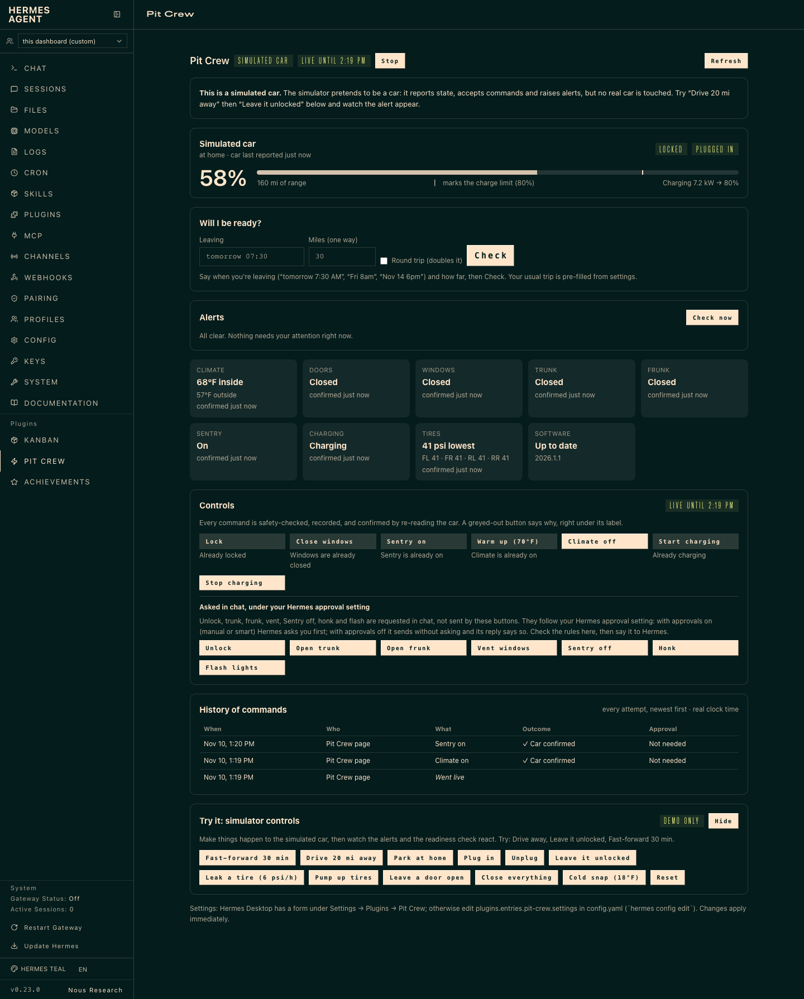

# Pit Crew

**Your car, looked after: inside Hermes.**

Pit Crew gives your Hermes agent a car it can actually take care of. It knows how charged, locked and warm the car is
right now, remembers how you drive, tells you tonight whether you'll make tomorrow's trip, and keeps watch while you
sleep. When it wants to touch the car it follows your Hermes approval setting: it asks you first when approvals are on, and says so when they are off.

*A skill can't watch your car at 2 AM. This does.*

<!-- TODO(owner): add docs/screenshots/pit-crew-page.png (see docs/screenshots/README.md), then remove these comment markers.

-->

[](https://github.com/trevornk/pit-crew/actions/workflows/ci.yml)   

## A day with Pit Crew

* **Morning.** *"Warm the car."* It's warming ten minutes before you leave, on wall power. If you asked at 11 PM for
  7:20 AM, it waits and does it then.
* **Evening.** *"Will I make my 8:30 dentist appointment tomorrow?"* It checks your calendar, the distance, tomorrow's cold
  and **your own** winter efficiency, then answers *Ready*, *Tight* or *Not ready*, and tells you what to do about it
  (for example, raise the charge limit).
* **While you're out.** Your phone buzzes: *"Your car is unlocked and away from home. Want me to lock it?"* Say "yes". It
  locks the car and reads the car's state back to confirm it worked.
* **Any time.** *"Unlock the car"* goes through Hermes' approval gate: with approvals on, Hermes asks you first. If the car is moving, away from home, asleep, or its
  data is stale, Pit Crew says no and tells you why.

*(Wording is illustrative; the behaviour is what the simulator and the tests exercise.)*

**No car? No problem.** Pit Crew ships with a simulated car, so you can try all of this in a minute.
It works with **Home Assistant** (Tesla, BMW, Kia/Hyundai and more), **Teslemetry**, **Tessie**, and **TeslaMate** history.

## Try it in 60 seconds (no car needed)

```bash
hermes plugins install trevornk/pit-crew
hermes plugins enable pit-crew
```

Restart Hermes (and Hermes Desktop, if you use it). Then open **Pit Crew** in the sidebar, or type `/car` in any chat
(press **Enter**, not Tab, on `/car`: Tab can complete it to a similarly named skill). Updating later? See
[Update and restart](#update-and-restart).

Take the simulated car for a spin, by buttons on the page (**Try it: simulator controls**) or by typing:

```
/car                          the status card
will I be ready for a 40-mile trip tomorrow at 7:30?
/car sim leave_unlocked       leave the car unlocked ...
/car sim drive 10 away        ... and drive away from home
/car sim advance 15           fast-forward 15 minutes: the watcher raises an alert
/car lock                     fix it (practice mode: checked and logged, nothing is sent)
/car live                     go live (you confirm; it stops by itself after 1 h, or your "Go live for" setting;
                              with Live mode "always" there is nothing to do: it is live until you /car stop)
unlock my car                 Hermes asks YOU to approve, then reads the car back
/car log                      the audit trail
/car stop                     back to practice mode (in "always" mode: a pause until /car live)
```

Right after `drive … away`, unlock is correctly **refused** (it only works at home): read the reason, then try
`/car sim park_home` and `/car sim plug_in`. `/car sim` lists everything the simulated car can do.

## Connect your real car

Pick one source for the car (**Settings → Plugins → Pit Crew → Connection · Which car**). Changes apply immediately: run
`/car` to check. History needs nothing extra: Pit Crew records trips, charging and efficiency itself.

| Connection | Best if… | Setup | Costs | Commands? |
|---|---|---|---|---|
| **simulator** (default) | you want to try it, or have no supported car | none | free | simulated |
| **homeassistant** | you already run Home Assistant with a car integration (Tesla Fleet, Teslemetry, Tessie, BMW, Kia/Hyundai…) | ~10 min | free | yes, through HA |
| **teslemetry** | you have a Tesla and want the shortest path | ~5 min | Teslemetry subscription | yes |
| **tessie** | you already use Tessie | ~5 min | Tessie subscription | yes |
| **teslamate** | you run TeslaMate and want its past data | ~5 min | free | never (read-only) |

Your own Tesla Fleet API app works through Home Assistant's official Tesla Fleet integration (HA holds the Tesla tokens;
Pit Crew holds none).

**No Desktop?** Everything below can be done in `config.yaml` (`hermes config edit`) and your profile's `.env`
(`hermes config env-path` prints where it is). Tokens always go in `.env`, never in `config.yaml`.

<details open>
<summary><b>Home Assistant</b></summary>

1. In Home Assistant: your profile → **Security → Long-lived access tokens** → create one (a dedicated HA user is ideal).
2. Settings (Desktop form: **Settings → Plugins → Pit Crew**):
   * Desktop: *Connection · Which car* = `homeassistant`, *Home Assistant · URL*, *Home Assistant · Access token*.
   * Headless:
     ```yaml
     # config.yaml
     plugins:
       entries:
         pit-crew:
           settings:
             adapter: homeassistant
             ha_url: http://homeassistant.local:8123
     ```
     ```bash
     # profile .env
     PIT_CREW_HA_TOKEN=<your long-lived token>
     ```
3. Run `/car discover`. It reads Home Assistant read-only, finds your car and tells you the *Car name* (like `my_car` for
   `sensor.my_car_battery_level`) and the *brand mapping* (for a Tesla: `tesla_fleet`). Enter both (`ha_slug`, `ha_profile`).
4. **Tesla Fleet or Teslemetry integration:** Home Assistant ships several useful entities disabled: *Shift state* and *Speed* (without a
   motion source Pit Crew refuses unlock/trunk/frunk/vent, because it can't prove the car is parked), *Odometer*, and the four
   *Tire pressure* sensors (needed for the low-tire and fast-air-loss alerts). Enable them: Settings → Devices & services →
   Tesla Fleet (or Teslemetry) → your car → entities → show disabled entities. Tessie ships those enabled. `/car discover`, `/car` and `car_status` list exactly which ones
   are still missing.
5. `/car`: compare with the car's app. Stay in practice mode until the numbers match.

Bundled mappings: `tesla_fleet` (built and tested against sanitized recordings of a real Model Y, and its entity names
checked against Home Assistant core's source); `teslemetry_ha` and `tessie_ha` for Home Assistant's **`teslemetry`** and
**`tessie`** integrations (**verified against Home Assistant core's source and synthetic test states, not run on a real car**;
they differ from `tesla_fleet` in a few names, and Pit Crew will not accept their "P" gear or 0 speed as proof the car is parked,
so unlock/trunk/frunk/vent need the car plugged in or a TeslaMate state entity; details in
[docs/HA_TESLA_INTEGRATIONS.md](docs/HA_TESLA_INTEGRATIONS.md)); `kia_hyundai_connect` for the **HACS custom integration**
[kia_uvo](https://github.com/Hyundai-Kia-Connect/kia_uvo) v4 and `bmw_connected_drive` (**verified against each integration's
source and test data, not run on a real car**). Note: Home Assistant **removed** the BMW Connected Drive integration in March
2026 after BMW blocked third-party access, so that mapping only fits an install that still has the old entities. Another brand? `/car discover` proposes a generic mapping, and a mapping
is a small JSON file ([docs/ADAPTERS.md](docs/ADAPTERS.md)).
</details>

<details>
<summary><b>Teslemetry or Tessie</b></summary>

1. Subscribe, create an access token, note your car's 17-character VIN.
2. Desktop: *Connection · Which car* = `teslemetry` (or `tessie`), *Tesla · VIN*, *Tesla · Access token*.
   Headless: `adapter: teslemetry` and `tesla_vin: <VIN>` under `plugins.entries.pit-crew.settings`, and
   `PIT_CREW_TESLA_TOKEN=<token>` in `.env`.
3. **Recommended:** set *Tesla · Home latitude/longitude* so Pit Crew knows when the car is home. Without it the car's place is
   "unknown", so unlock and the *left unlocked away from home* alert can't work. (Coordinates never leave the adapter: they're
   turned into a place name immediately and never stored, output or logged. Copy them from any map app.)
4. `/car`, then compare with the Tesla app.

Pit Crew never wakes a sleeping car just to read it: an asleep car's last data is shown as "last known".
The `tesla-fleet-api` library is installed for you by `hermes plugins install` (manually: `pip install "tesla-fleet-api>=1.5,<2"`).
</details>

<details>
<summary><b>TeslaMate (history, and fresher state next to Home Assistant)</b></summary>

Set *TeslaMate · URL* to your **TeslaMateApi** (the separate `teslamateapi` container, e.g. `http://teslamate-api:8080`; not the
TeslaMate web UI on port 4000), and *TeslaMate · Access token* only if you set `API_TOKEN` on TeslaMateApi. *TeslaMate · Car id* is
usually 1. Only read-only `GET` requests are ever made; TeslaMate never sends a command.

* **History:** run `/car import teslamate 365` to backfill a year of trips and charges (safe to repeat), or set *Trip & charging
  history* = `teslamate` to read it live.
* **Fresher state next to Home Assistant:** with *Which car* = `homeassistant` and a TeslaMate URL set, every status read also asks
  TeslaMateApi (`/api/v1/cars/<id>/status`) and, field by field (locked, doors, windows, trunk, frunk, Sentry, gear/speed/moving,
  place, charging state/power, battery/range), keeps **whichever source reported more recently**. `car_status` → `freshness.field_sources`
  says which one each field came from. Commands still go only through Home Assistant. TeslaMateApi gives no per-field times, only the
  car's state and when it last changed, so Pit Crew is careful: while the car sleeps its TeslaMate values count as of that change,
  while awake as 60 s old, and a value that changed since Pit Crew's previous look as of that look. A command's read-back counts
  TeslaMate only when it shows the change after the command was sent. Any reading of gear D/R/N or a speed, from either source,
  still means "moving". If TeslaMate is unreachable, Home Assistant alone is used. Pit Crew does not use TeslaMate's MQTT sensors
  in Home Assistant for this, so you don't need them.
</details>

### Update and restart

Hermes runs `/car` in whichever process owns your chat: **Hermes Desktop and the web dashboard chats use the
`hermes dashboard` process; messaging apps (Telegram and so on) use the gateway.** Both import the plugin's code when they
start, so an update only takes effect once both have reloaded it.

```bash
hermes plugins update pit-crew       # pulls the new code. On Hermes 0.23 it does NOT reload running processes.
hermes gateway restart               # then restart the gateway ...
# ... and restart `hermes dashboard` / Hermes Desktop
```

* Or update from **Hermes Desktop → Capabilities → Plugins → Update**: that path reloads the running backend and nudges the
  gateway for you.
* No command-line install/update/enable reloads a running process on Hermes 0.23 (`install --force` and `enable` don't either).
* Then, in Hermes Desktop, run **Reload desktop plugins** (⌘K). That also refreshes the `/car` autocomplete.
* Not sure which version is running? `/car help` (or any unknown subcommand) prints it: "Pit Crew 0.2.0".

### Hermes Desktop on a different machine

Desktop loads the Pit Crew page from **its own machine's** plugin folder. Installing on the Hermes server doesn't put the
page into a Desktop app that connects to it remotely.

1. On the Hermes server: `hermes plugins install trevornk/pit-crew`, `hermes plugins enable pit-crew`, restart.
2. In the Desktop app: **Capabilities → Plugins → Install from Git**, repo `trevornk/pit-crew`, *Desktop* target checked
   (or open `hermes://plugin/install?repo=trevornk/pit-crew`). Toggle *Pit Crew* on.
3. Open **Pit Crew** in the sidebar. If it says it isn't running, step 1 isn't complete or the server wasn't restarted.
4. After updating the plugin on the server, update it in the Desktop app too (Capabilities → Plugins → Pit Crew → Update), then
   press **Rescan** and reload the window. Updating the server does not update the page on another machine.

`/car desktop-install` prints these steps. No Desktop? `hermes dashboard` has a Pit Crew tab, and `/car` works in any chat.

### Get alerts on your phone

Alerts are always stored (Pit Crew page, `/car alerts`) and mentioned the next time you talk to Hermes. To have them **pushed** to
the app you use, give Pit Crew a Hermes *delivery target*: the same string a cron job's `deliver` takes. Pit Crew then sends each alert
through Hermes' own cross-platform send (the code behind cron delivery and `hermes send`): a plain message to the platform, no agent
turn, no gateway session needed, and it works from any Hermes process that has the platform set up.

```
/car notify here                      # in a Telegram/Discord/Matrix/Signal/Slack chat: use this chat
/car notify telegram                  # Telegram home channel
/car notify telegram:-1001234567890   # a specific Telegram chat (add :topic for a topic)
/car notify discord:#car              # a Discord channel (by name needs Hermes' channel directory; an id always works)
/car notify matrix:!room:example.org  # a Matrix room
/car notify signal:+15551234567       # a Signal number
/car notify list                      # what Hermes knows about
/car notify test                      # send a test message now and show the platform's answer
```

Or set **Alerts · Where alerts go** (`alert_target`) in Settings → Plugins → Pit Crew. **The setting wins** when it is set; otherwise the
target stored by `/car notify`. The platform itself (bot token, Matrix login, home channel for a bare name) is set up in Hermes as for
cron; Pit Crew stores no credentials. `/car notify test` and every real push report Hermes' own answer: success means the platform
accepted the message, and a failure is shown with the platform's reason (wrong target, bot blocked, platform not configured, no
home channel). A failed push is retried with backoff (30 s, doubling to 30 min) for 6 hours, then given up on and said so; the alert stays in
`/car alerts` and in your next chat's context either way. It is **not** cancelled by the alert being shown in some other chat.

On the Desktop app or CLI with **no messaging platform**, there is nothing to push to: `/car notify here` says so, alerts show on the
Pit Crew page and in the next chat. `allow_gateway_injection` is no longer needed. An alert about charging stopping is not raised when
Pit Crew itself stopped the charge in the last 30 minutes.

*Tested:* Matrix (live), and against the real Hermes send code with a fake network layer for Telegram, Discord (by id), Signal and Matrix targets.
Slack, WhatsApp, SMS, e-mail and other platforms use the same call but were not tested; Discord/Slack channel *names* need Hermes' channel directory
(`/car notify list`).

## Safe by design

Safety isn't a setting you remember to turn on; it's how Pit Crew works.

* **You choose how commands go live** (**Safety · Live mode**, `live_mode`):
  * `on_demand` (the default for a new install): practice mode until you tap **Go live** or type `/car live`; commands are
    checked and logged but never sent until then. Going live stops by itself: after **Safety · Go live for (hours, 1-24)**
    (`live_default_hours`, default 1 h) for the button and a plain `/car live`, or after the hours you type (`/car live 3`;
    15 min to 72 h).
  * `always`: commands are sent for real without `/car live` first, so "open the trunk" just works. `/car stop` (or **Stop**
    on the page) pauses it: practice mode until you run `/car live` or press **Go live** again, which resumes it with no time
    limit. `/car`, the page and the status-bar chip always say which applies: *Live: always on*, *Paused (practice) — /car
    live to resume*, or *Live until 4:39 PM*.
  * Either way every other protection below still applies, and Hermes itself can never go live or change these settings:
    only the setting, your `/car live` or your click.
* **"Confirmed" means the car said so.** Home Assistant's Tesla integrations show a command's result the moment Tesla accepts it, before
  the car is re-read (tesla_fleet re-reads about every 10 minutes). Pit Crew does not count that as confirmation: it says "accepted, the
  car hasn't reported back yet" until a real re-read shows the change, and only says "already locked/closed" when the car reported it
  under a minute before the command.
* **Risky commands follow your Hermes approval setting.** Unlock, trunk, frunk, window vent, Sentry-off, honk and flash go
  through Hermes' own approval gate. With approvals on (`manual` or `smart`) Hermes asks **you**. (In `smart` mode Hermes still
  asks a person for plugin approvals; it does not hand them to its guardian.) With approvals `off` or yolo, Hermes doesn't ask,
  and neither does Pit Crew: the result and `/car log` say "Sent without asking / approved by Hermes (no prompt)". If you
  want a person every time regardless, list commands under *Advanced · Always ask a person for these*. They are never a button
  in Pit Crew's own pages (those draft the request for Hermes). Scheduled jobs can't answer prompts, so for them the answer is
  always *no* (Pit Crew keeps that floor even when Hermes' `cron_mode` is `approve`).
* **It refuses when it can't be sure.** Not while the car is moving; not on stale data; not if the car is asleep (it won't
  wake it to be nice); unlock only at places you trust; bounded temperatures, limits and amps; rate-limited; repeats skipped.
  Every refusal names the setting that would allow it, if there is one.
* **You can adjust the protections that are a matter of taste** (Settings → Plugins → Pit Crew, *Safety* section; a new
  install starts at the careful choice):

  | Setting | Choices (default first) | Risk of loosening it |
  |---|---|---|
  | Live mode (`live_mode`) | `on_demand` · `always` | With `always`, a chat that convinces Hermes can send right away; keep Hermes approvals on for unlock/trunk if others can talk to it. |
  | Unlock/trunk/frunk zone (`zone_rule`) | `trusted_zones` · `anywhere` | With `anywhere`, the car can be opened wherever it is parked (the walk back to the car in a car park). |
  | Wake a sleeping car for a command (`wake_for_commands`) | `ask` · `auto` | With `auto`, a command you asked for wakes the car (some battery) without a second question. Status reads never wake it. |
  | Refuse risky commands when data is older than (`max_state_age_s`) | 600 s; 60-3600 | Older data means acting on an older picture of the car. It cannot be switched off. |
  | Max commands per window / window (`rate_limit_commands`, `rate_limit_window_s`) | 10 per 600 s; 1-60 per 60 s-1 day | |
  | Ignore a repeated command for (`dedupe_window_s`) | 60 s; 5-600 | |
  | Always ask a person for these (`require_human_for`) | none | (Tightens, never loosens.) |
  | Hermes' own approval mode | Hermes' setting, not Pit Crew's | See above. |

  Some things are **not** settings, on purpose: nothing unlocks or opens while the car is moving or can't be shown to be
  parked; unlock/trunk/frunk/vent/Sentry-off/honk/flash never run from a scheduled or background job; Hermes cannot go live or
  change these settings itself; and results always say truthfully whether the car confirmed a command or Tesla only accepted it.
  A car that reports it is **asleep** right now counts as parked (a Tesla cannot sleep in gear), so with `anywhere` and `auto`,
  "open the trunk" works as you walk back to the car — but a reading of D/R/N or a speed still refuses it.
* **It checks the car actually did it,** and tells you if it couldn't tell (or if a timeout means it may have gone through). It
  only counts a reading the car's integration wrote *after* the command, never a switch Home Assistant flipped on its own, and it
  says "already locked / closed" when that was the case. Charging commands wait up to 90 s for the car's report where that
  helps. Tesla Fleet in Home Assistant only re-reads the car every ~10 minutes on its own, so there Pit Crew asks Home Assistant
  to **re-read the car once** about 5 s after a command and answers from that: "the car confirmed it" only when the car's
  fresh report shows the change, otherwise "Tesla accepted it" with the reason (the re-read showed the old value, found the car
  asleep, or didn't happen). This adds up to ~10 s to the reply and costs one Tesla Fleet data request per command (about
  $0.002 at Tesla's 500 requests per $1). It never happens for status reads or honk/flash, and it never wakes the car
  (Home Assistant only fetches the car's data when Tesla says it is online). Turn it off with *Advanced · Re-read the car once
  after a command* (`refresh_after_command`); then Pit Crew reads once and answers straight away ("Tesla accepted it; the car
  reports back within ~10 min; check status later").
* **Defrost runs heat and fan at maximum** (a Tesla's max defrost). Pit Crew's agent is told to say so, and the result reminds you; do
  not turn it on with a person or pet in the car without telling them first.
* **Everything is on the record:** who asked, what happened, whether you approved.

Full details and the threat model: [docs/SAFETY.md](docs/SAFETY.md).

## What it can do

| | |
|---|---|
| **Status** | Battery, range, charging, lock, doors, windows, trunk/frunk, Sentry, cabin and outside temperature, tire pressures (psi), which *place* the car is at, software update, each with how fresh it is. What a car can't report is shown as unavailable, never guessed. |
| **History** | Trips, charging sessions, cost, efficiency by temperature, week-over-week trend, battery health, all recorded by Pit Crew itself. |
| **Readiness** | "Will I be ready?": the charge you need (your efficiency + margin + reserve) versus what you'll have, and what to do about it. |
| **Commands** | One gated command tool; shortcuts `/car lock`, `/car warm [°F]`; everything else in plain language. |
| **Watcher** | Twelve toggleable alerts: left unlocked away from home, unlocked at home at night, window/door/trunk open, plugged in but not charging, charging stopped early, not enough charge for tomorrow, Sentry off away from home, cabin dangerously hot/cold with someone inside, a low tire, a tire losing air fast, the car's own tire warning, software update. Stale or missing readings never raise an alert. |
| **Surfaces** | `/car`, the Pit Crew page in Hermes Desktop (with a status-bar chip), the web dashboard tab, three one-command automations (morning brief, warm up before you leave, nightly lock check), and a bundled skill that teaches the agent to use it well. |

## What has and hasn't been verified

Honesty matters more than a long feature list.

* **Run against a real car (read-only):** the Home Assistant `tesla_fleet` connection has read the status of the owner's real Model Y
  (battery, charging, lock, doors, climate, place). The sanitized recordings of that car are the test fixtures.
* **Real-car test (2026-11-09, Home Assistant `tesla_fleet`):** twelve commands that need no approval (lock, climate, set temperature,
  defrost, seat heat, charge start/stop, charge limit, charge amps, close windows, Sentry…) were sent; the owner saw the car do each of
  them. That test also found, and this version fixes, stale charging data shown as current, charging read-back that could not see the
  car's answer, and alerts that were never retried to the bound chat. A second session the same day sent the approval commands
  (unlock, trunk, frunk, vent, Sentry off, honk, flash): the car did each one; it showed that Home Assistant's own instant "new state"
  had been read as the car's confirmation and that a 5-minute-old "unlocked" was read as "already unlocked". Both are fixed.
* **Tested without a car:** the safety engine, the approval flow (against Hermes' real approval pipeline, run in CI against Hermes
  v0.23.0, with a scripted human), the watcher, readiness math, history, both pages (rendered and clicked through in Node/jsdom),
  and the plugin loading in real Hermes. See `tests/` (about 650 tests, no network; CI fails if any is skipped).
* **Checked against source, not run on a car:** the Kia/Hyundai profile (the `kia_uvo` HACS integration, v4) and the BMW profile
  (Home Assistant's last version of the since-removed integration), against each project's entity names and test data.
  The tire-pressure and odometer entities of `tesla_fleet` are checked against Home Assistant core's source.
* **Mocks only:** Teslemetry and Tessie are tested against mocks of the `tesla-fleet-api` library.
* **Not yet exercised live:** Telegram/Discord approval buttons and chat pushes, and the pages inside the real apps. If a
  surface doesn't deliver Hermes' approval response, the audit shows "approved by Hermes (no prompt)" instead of "you approved"; let us know.

Start with the simulator; stay in practice mode until `/car` matches the car's own app.

## FAQ

**Do I need a car?** No. The default connection is a simulated car.
**Does it need TeslaMate?** No. It records its own history. TeslaMate import is optional.
**Can it unlock my car by itself?** Not from a scheduled job, ever. In chat, unlock follows your Hermes approval setting: Hermes asks you when its approvals are on; if you turned them off (or use yolo) it doesn't, and neither does Pit Crew unless you list unlock under *Always ask a person for these*.
**Does it wake my car and drain the battery?** No. It reads cheap state only; commands that wake the car need your OK (or
the *Wake a sleeping car for a command* setting at `auto`, for commands you ask for).
**What does it send out?** Only requests to services you configured (your Home Assistant, Teslemetry/Tessie, TeslaMateApi). No telemetry.
**Does it store my location?** No coordinates. It keeps place names ("home", "away") and trip distances.
**Which Hermes?** 0.23 or newer.

## Troubleshooting

| You see | Do this |
|---|---|
| Page says *Connect your car* | Open Settings → Plugins → Pit Crew and fill in the section for your connection (or the config.yaml/.env lines above). The page shows exactly what's missing. |
| *Pit Crew isn't running on this Hermes* | `hermes plugins enable pit-crew`, restart Hermes. Desktop on another machine: see above. |
| `/car` says "Unknown subcommand" for something that should exist | The process answering still runs old code: restart `hermes dashboard` / Desktop and the gateway (`hermes gateway restart`), or update from Desktop → Capabilities → Plugins (see [Update and restart](#update-and-restart)). The reply names the running version. |
| Unlock is refused: "cannot confirm the car is parked" | Enable HA's *Shift state* and *Speed* entities, or plug the car in. |
| Odometer or tire pressure show "not reported" | Home Assistant ships those entities disabled: enable *Odometer*, the *Tire pressure* sensors and the *Tire pressure warning* sensors (`/car` shows the steps). |
| Unlock is refused: "away from your trusted zones" | Check the car's place on `/car`. For Teslemetry/Tessie, set Home latitude/longitude. To allow it anywhere, set *Safety · Unlock/trunk/frunk zone* to `anywhere`. |
| Alerts show on the page but never reach your phone | Set where they go: `/car notify here` in that chat, or `/car notify telegram` (etc.), then `/car notify test`. `/car notify status` shows the target and Hermes' answer to the last attempt. |
| "Practice run" when you wanted to send | You're in practice mode (or paused): **Go live** (page) or `/car live`. To skip this step for good, set *Safety · Live mode* to `always`. |
| Settings changed but nothing happened | They apply immediately: run `/car`. Check *Connection · Which car*. |

## Reference

**Tools** (the agent uses them): `car_status`, `car_history`, `car_readiness`, `car_command`, `car_alerts`, `car_rules`.

**`/car`**: `ready [when] [mi]` · `lock` · `warm [°F]` · `alerts [ack [id]]` · `live [hours]` · `stop` (= `practice`) · `log [n]` ·
`rules` · `notify here|<target>|off|status|test|list` · `discover` · `import teslamate [days]` · `desktop-install` · `sim …` (simulated car only).
(`arm` and `disarm` still work as aliases.)

**Automations** (ordinary cron jobs, one command each): `/blueprint pit-crew:morning-brief`, `:precondition`, `:nightly-security`.

**Skill** `pit-crew:car-agent`: calendar-aware readiness; "never claim a command worked without read-back".

**Storage:** a SQLite file in the plugin's data directory (audit log, alerts, trips and charging sessions with place names
and distances, simulator state), readable only by you. No VINs; VIN and token patterns are also registered with Hermes' redactor.

## Privacy and risk

* **Network:** only to the services you configure. No telemetry.
* **Credentials:** declared secrets, read only through Hermes' secret scope; never in config, logs or output. Pit Crew stores no OAuth tokens or key files.
* **Reads outside its data:** only a custom Home Assistant mapping file, if you point *brand mapping* at one.
* **Pushed alerts:** if you set a delivery target, alert text (zone name, rule, percentages; no coordinates, VIN or credentials) is sent to that platform via Hermes. Leave it empty to keep alerts local.
* **Background process:** one watcher polls every 2 minutes (15 while the car sleeps) and never wakes the car.
* **Risk:** once live *and* approved, software can unlock and open a real car. Read [docs/SAFETY.md](docs/SAFETY.md), start in
  practice mode, use a dedicated Home Assistant user, and don't expose the Hermes dashboard to the internet.

## Write an adapter for another car

The brain (state model, commands, readiness, rules, safety) is platform-independent. A car platform is one small module that
says what it can read and do, fetches a `VehicleState`, and sends commands. Ship it as a pip package with an entry point and it
plugs in without touching this repo: [docs/ADAPTERS.md](docs/ADAPTERS.md) has a 30-line example.

## Development

```bash
python3 -m venv ~/.venvs/pit-crew      # keep the venv OUTSIDE the plugin directory
~/.venvs/pit-crew/bin/pip install pytest pytest-asyncio pyyaml fastapi httpx
~/.venvs/pit-crew/bin/python -m pytest tests   # no network; the Hermes and Node tests skip if absent
hermes plugins validate .                      # catalog admission checks
```

The plugin id (`pit-crew`) is defined in `constants.py`, `plugin.yaml`, `dashboard/manifest.json` and `desktop/plugin.js`,
mostly; `grep -rn pit-crew` finds the rest. Design notes: [docs/DECISIONS.md](docs/DECISIONS.md) · [docs/STATUS.md](docs/STATUS.md) ·
catalog entry: [catalog/pit-crew.yaml](catalog/pit-crew.yaml).

MIT licensed.
